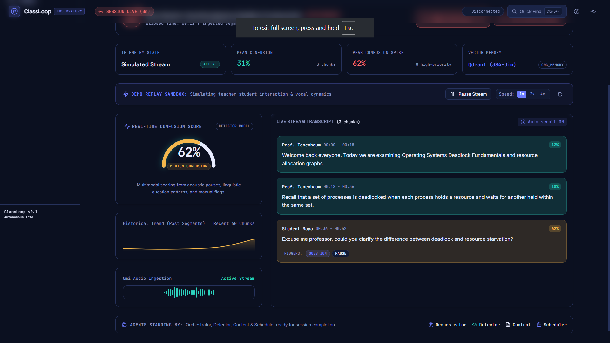
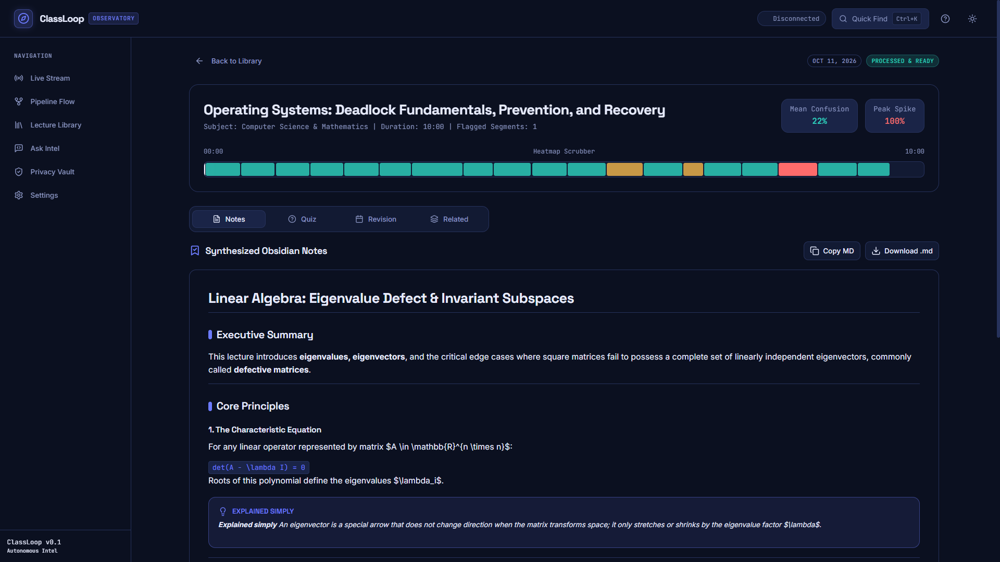
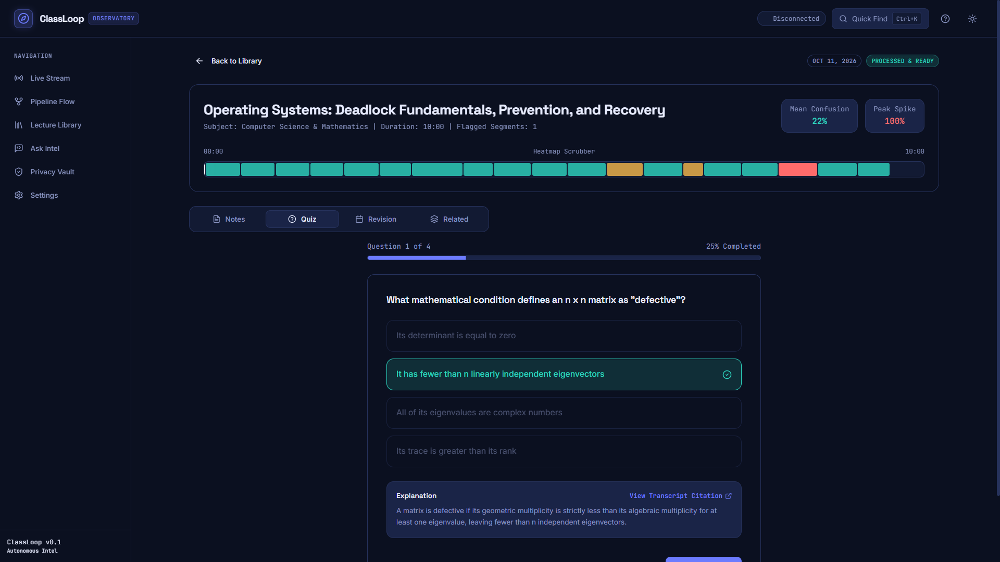
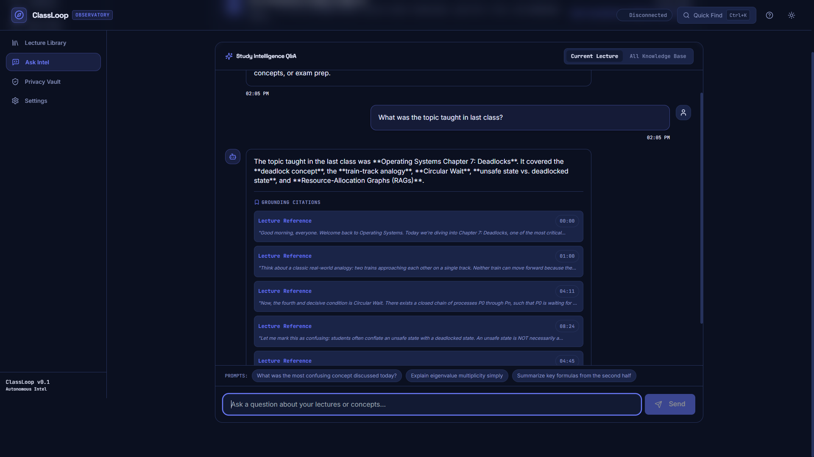
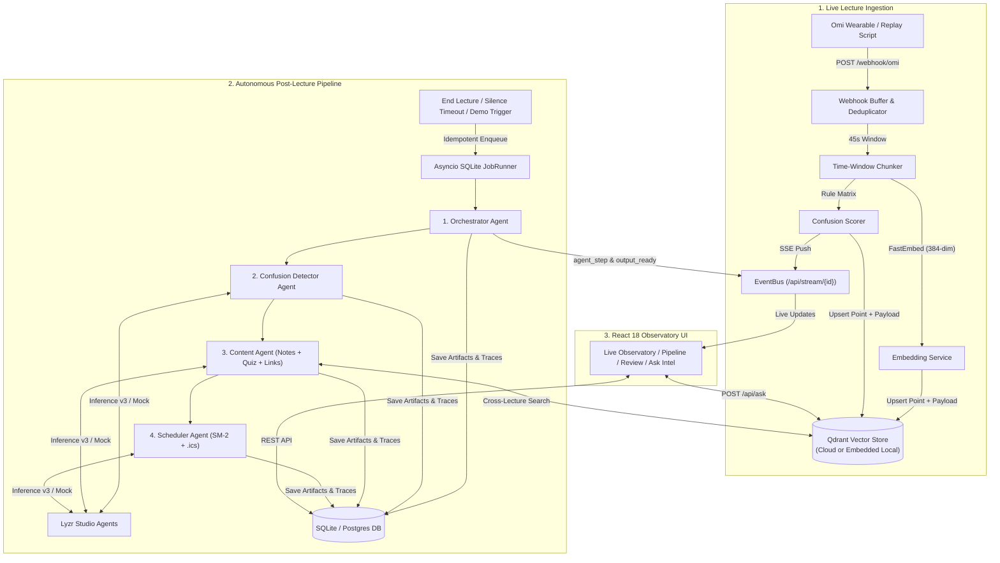

# ClassLoop: Autonomous Lecture Intelligence Observatory

> **Ambient lecture intelligence powered by Omi wearable hardware, Qdrant vector memory, and Lyzr multi-agent orchestration.**

[](https://classloop-observatory.netlify.app)
[](https://www.python.org/)
[](https://fastapi.tiangolo.com)
[](https://react.dev)
[](https://www.typescriptlang.org/)
[](https://qdrant.tech/)
[](https://www.lyzr.ai/)
[](LICENSE)

> **Live Deployment (Netlify)**: [https://classloop-observatory.netlify.app](https://classloop-observatory.netlify.app)

ClassLoop listens to live lectures through the [Omi](https://omi.me) wearable pendant, detects the exact moments students experience cognitive friction, and acts autonomously the moment the lecture ends. Using [Lyzr Studio](https://www.lyzr.ai/) agents for reasoning and [Qdrant](https://qdrant.tech/) as shared semantic memory, ClassLoop synthesizes confusion-weighted study notes with plain-English analogies, generates a cited active-recall quiz, builds an Ebbinghaus spaced-repetition schedule exported as a standard `.ics` calendar file, and links concepts across earlier lectures.

The entire platform runs as a single lightweight process (one `uvicorn` worker serving the FastAPI backend, the async SQLite-backed job runner, SSE live streams, and the compiled React Observatory UI) with zero Docker or Redis dependencies.



---

## Table of Contents

1. [Product Highlights & Complete Feature List](#1-product-highlights--complete-feature-list)
2. [Visual Walkthrough & Screenshots](#2-visual-walkthrough--screenshots)
3. [System Architecture & Data Flow](#3-system-architecture--data-flow)
4. [Multimodal Confusion Scoring Engine](#4-multimodal-confusion-scoring-engine)
5. [Autonomous Multi-Agent Pipeline](#5-autonomous-multi-agent-pipeline)
6. [Spaced Repetition & RFC-5545 Calendar Export](#6-spaced-repetition--rfc-5545-calendar-export)
7. [Quickstart & Installation](#7-quickstart--installation)
8. [Running the Demo (Web UI & CLI)](#8-running-the-demo-web-ui--cli)
9. [REST & SSE API Surface](#9-rest--sse-api-surface)
10. [Configuration & Environment Variables](#10-configuration--environment-variables)
11. [Privacy Vault, Encryption & Security](#11-privacy-vault-encryption--security)
12. [Repository Layout](#12-repository-layout)
13. [Testing, Linting & Deployment](#13-testing-linting--deployment)

---

## 1. Product Highlights & Complete Feature List

### Live Lecture Ingestion & Telemetry (P0)
- **Omi Webhook Ingestion (`POST /webhook/omi`)**: Verifies shared webhook secrets, deduplicates transcript segments by `segment_id`, buffers active sessions in memory, and responds in under 200 ms without blocking on downstream LLM calls.
- **Time-Windowed Chunking**: Automatically aggregates raw speech segments into 45-second pedagogical windows (`CHUNK_SECONDS=45`) with speaker attribution and exact start/end timestamps.
- **Local & Cloud Vector Embeddings**: Defaults to zero-key local embeddings via `fastembed` (`BAAI/bge-small-en-v1.5`, 384 dimensions) and supports OpenAI-compatible embedding endpoints (`text-embedding-3-small`). Validates collection dimensions at startup to prevent vector mismatch.
- **Real-Time Multimodal Confusion Scoring**: Evaluates every 45-second chunk for lecturer rephrases, student questions, comprehension check-ins, acoustic pauses, embedding topic shifts, and manual flags.
- **Hands-Free Voice Commands**: Fuzzy-matches spoken phrases such as *"mark this as confusing"* or *"bookmark this"* during a live lecture to pin a `1.0` confusion score to the active chunk, and recognizes *"end lecture"* or *"class dismissed"* to close the session automatically.
- **One-Click Manual Flagging**: Press `M` on the keyboard or click **Mark Confusing** in the Live Observatory to flag the current segment in Qdrant and emit a real-time `flag_added` event.
- **Automatic End Detection**: Closes a lecture session via voice command, manual UI trigger (`POST /api/lectures/{id}/end`), or the background inactivity watcher (`SILENCE_TIMEOUT_SECONDS=90`).
- **Server-Sent Events (`GET /api/stream/{lecture_id}`)**: Streams `segment`, `chunk_scored`, `flag_added`, `lecture_ended`, `agent_step`, and `output_ready` events with automatic client reconnection and keepalive heartbeats.

### Autonomous Post-Lecture Intelligence (P0)
- **In-Process Async Job Runner**: SQLite-backed `jobs` table (`pending`, `running`, `completed`, `failed`) with idempotent `lecture_id` keys, exponential backoff retries, manual retry endpoint (`POST /api/lectures/{id}/retry`), and automatic crash recovery on server startup.
- **4-Stage Lyzr Multi-Agent Swarm**: Coordinated execution across **Orchestrator**, **Confusion Detector**, **Content Agent**, and **Scheduler Agent**, with strict Pydantic schema validation, automatic validation-error retry, and per-step latency tracing.
- **Confusion-Weighted Obsidian Markdown Notes**: Generates executive summaries, structured topic breakdowns, and dedicated **"Explained Simply"** intuition callout blocks for every concept with confusion score `>= 0.40`. Includes one-click **Copy MD** and **Download .md**.
- **Cited Active-Recall Quiz**: Produces 5 multiple-choice questions weighted toward high-confusion topics. Every question includes immediate answer grading, a detailed explanation, and a verifiable citation linking back to the exact transcript chunk and timestamp.
- **Ebbinghaus Spaced-Repetition Schedule & `.ics` Export**: Calculates review milestones (`Day +1`, `Day +3`, `Day +7`, `Day +14`) based on topic confusion severity and exports a downloadable RFC-5545 `.ics` calendar file compatible with Google Calendar, Apple Calendar, and Outlook.

### Cross-Lecture Memory, RAG & Privacy Controls (P1)
- **Cross-Lecture Semantic Linking**: Searches across earlier lectures in Qdrant for every flagged topic and attaches prerequisite or follow-up concept links with cosine similarity scores.
- **Ask Intel Multi-Lecture RAG (`POST /api/ask`)**: Answers natural-language study questions across either the active lecture or the user's entire knowledge base, returning grounded explanations alongside timestamped verbatim transcript citations.
- **Three-Tier Privacy Vault**: Per-lecture visibility controls (`private`, `shared`, `ephemeral`). A background TTL reaper automatically purges expired `ephemeral` points from Qdrant after `EPHEMERAL_TTL_HOURS` (default 24 hours).
- **Hard-Purge Right to Forget (`DELETE /api/lectures/{id}`)**: Irreversibly deletes all vector points from Qdrant and cascades deletion across SQLite tables (`lectures`, `outputs`, `jobs`, `agent_traces`) in one click.
- **Runtime Encrypted Settings & Live Connection Testers**: Admin-protected settings console (`GET/PUT /api/settings`) that encrypts API keys at rest using Fernet (`SECRET_KEY` derived via SHA-256), never exposes raw secrets (`{set, last4, source}`), applies changes at runtime without a server restart, and tests live connectivity and latency to Omi, Lyzr, Qdrant, and Embeddings (`POST /api/settings/test/{integration}`).
- **Observatory Design System**: Custom Dark (`#0B1020`) and Light (`#F6F7FB`) themes, `Cmd/Ctrl + K` global command palette (`cmdk`), keyboard shortcut modal (`?`), interactive confusion weight sliders with live sample scoring, and responsive accessible Radix UI primitives.

---

## 2. Visual Walkthrough & Screenshots

### A. Live Observatory & Real-Time Confusion Telemetry
During a live or simulated session, the **Live Observatory** displays the 4-card telemetry strip, audio ingestion waveform, radial confusion gauge, 60-chunk historical trend sparkline, and streaming transcript cards annotated with detected confusion triggers (`QUESTION`, `PAUSE`, `REPHRASE`).


### B. Autonomous Multi-Agent Pipeline Execution Trace
When a lecture concludes, the **Pipeline Flow** view visualizes the 4-agent DAG (`Orchestrator -> Detector -> Content -> Scheduler`) in real time, displaying execution status, step latency in milliseconds, and inspectable JSON input/output payloads for every agent.


### C. Confusion Heatmap Timeline & Synthesized Study Notes
The **Lecture Review** page features an interactive color-coded confusion heatmap scrubber (`00:00` to `10:00`) paired with synthesized Markdown notes. High-confusion concepts automatically receive an **Explained Simply** callout block and one-click `.md` export.



### D. Confusion-Weighted Active Recall Quiz with Citations
The **Quiz** tab tests comprehension on the highest-confusion segments of the lecture. Selecting an option provides instant grading, a conceptual explanation, and a **View Transcript Citation** link to the exact moment in the lecture.



### E. 14-Day Spaced Repetition Horizon & `.ics` Calendar Export
The **Revision** tab maps out a 14-day spaced-repetition horizon (`Day +1`, `Day +3`, `Day +7`) alongside prioritized review milestones (`HIGH PRIORITY`, `MEDIUM`, `NORMAL`) and a one-click **Export .ics Calendar** download button.


### F. Ask Intel: Cited Multi-Lecture RAG Q&A
The **Ask Intel** page lets students query either the current lecture or their entire Qdrant knowledge base. Every response is grounded in retrieved vector chunks and accompanied by verbatim **Grounding Citations** with lecture timestamps.



---

## 3. System Architecture & Data Flow



For deeper architectural details, database entity diagrams, and adapter contracts, see [`docs/ARCHITECTURE.md`](docs/ARCHITECTURE.md) and [`docs/ASSUMPTIONS.md`](docs/ASSUMPTIONS.md).

---

## 4. Multimodal Confusion Scoring Engine

Implemented in [`backend/app/core/confusion.py`](backend/app/core/confusion.py), ClassLoop computes a deterministic real-time confusion score `S` in `[0.0, 1.0]` for every chunk by combining six pedagogical signals:

| Signal Category | Detection Mechanism | Score Weight | Reason Tag |
| :--- | :--- | :--- | :--- |
| **Lecturer Rephrase** | Matches phrases such as *"in other words"*, *"let me rephrase"*, *"to put it simply"*, *"wait let me explain again"* | `+0.25` | `Rephrase` |
| **Student Question** | Speaker is `"student"` or text contains `?` alongside *"why"*, *"how"*, *"what is"*, *"confused"*, *"don't get"* | `+0.30` | `Question` |
| **Comprehension Check-In** | Matches lecturer prompts such as *"does that make sense"*, *"any questions"*, *"are you following"* | `+0.20` | `Check-in` |
| **Acoustic Pause / Silence** | Inter-segment gap exceeding `6.0` seconds within the chunk window | `+0.15` | `Pause` |
| **Abrupt Topic Shift** | Cosine similarity between consecutive chunk embeddings drops below `0.35` (`1 - cos_sim > 0.65`) | `+0.10` | `TopicShift` |
| **Manual / Voice Flag** | Voice command (*"mark this as confusing"*) or UI **Mark Confusing** button (`M` key) | `1.00` (Override) | `Manual` |

 Users can customize these weights interactively in **Settings -> Behaviour & Weights** and preview the resulting confusion scores in real time against sample lecture segments.

---

## 5. Autonomous Multi-Agent Pipeline

When a lecture ends, [`OrchestratorAgent.run_pipeline`](backend/app/agents/orchestrator.py) coordinates four specialized agents backed by Lyzr Studio v3 (`POST /v3/inference/chat/`) or the deterministic [`llm_mock.py`](backend/app/adapters/llm_mock.py) engine:

| Stage | Module | Lyzr Agent Role | Validated Pydantic Schema | Output Artifacts |
| :--- | :--- | :--- | :--- | :--- |
| **1. Orchestrator** | [`orchestrator.py`](backend/app/agents/orchestrator.py) | `Decision Task Splitter` | `OrchestratorPlan` | Retrieves all lecture chunks from Qdrant, identifies flagged spikes, and initializes the execution DAG. |
| **2. Detector** | [`confusion_detector.py`](backend/app/agents/confusion_detector.py) | `Decision Task Splitter` | `DetectorOutput` (`list[Topic]`) | Clusters transcript chunks into pedagogical topics, merges rule-based and LLM-judged confusion scores, and extracts confusion reasons. |
| **3. Content** | [`content_agent.py`](backend/app/agents/content_agent.py) | `Organizational Memory Weaver` | `NotesOutput`, `QuizOutput`, `list[CrossLectureLink]` | Generates Markdown study notes with `"Explained simply"` blocks, a 5-question cited quiz, and cross-lecture Qdrant similarity links. |
| **4. Scheduler** | [`scheduler_agent.py`](backend/app/agents/scheduler_agent.py) | `Decision Task Splitter` | `ScheduleOutput` + `.ics` bytes | Applies spaced-repetition interval rules and builds an RFC-5545 `.ics` calendar file stored in base64 and served at `/schedule.ics`. |

Every agent call is wrapped with automatic Pydantic validation retry (appending the exact `ValidationError` on retry) and writes an audit record to the `agent_traces` table (`agent_name`, `input_hash`, `output`, `latency_ms`, `status`, `error`).

---

## 6. Spaced Repetition & RFC-5545 Calendar Export

Implemented in [`backend/app/core/scheduler_rules.py`](backend/app/core/scheduler_rules.py) and [`backend/app/core/ics.py`](backend/app/core/ics.py), ClassLoop translates topic confusion scores directly into retention review schedules:

- **High Confusion (`score >= 0.70`, Priority: `high`)**: Reviews scheduled at **Day +1, Day +3, Day +7, and Day +14**.
- **Moderate Confusion (`0.40 <= score < 0.70`, Priority: `medium`)**: Reviews scheduled at **Day +2, Day +6, and Day +14**.
- **Low Confusion / Calm (`score < 0.40`, Priority: `low`)**: Consolidation reviews scheduled at **Day +4 and Day +14**.

Each scheduled review is compiled into a standard RFC-5545 `VCALENDAR` / `VEVENT` payload downloadable from `GET /api/lectures/{id}/schedule.ics` or via the **Export .ics Calendar** button in the UI.

---

## 7. Quickstart & Installation

### Prerequisites
- **Python 3.11+**
- **Node.js 18+** and **npm**

### Option A: Windows PowerShell (No `make` required)
```powershell
# 1. Run automated setup (creates .env, Python .venv, installs backend & frontend packages, runs Alembic migrations)
powershell -ExecutionPolicy Bypass -File .\scripts\setup.ps1

# 2. Build the React frontend into frontend/dist
cd frontend
npm run build
cd ..

# 3. Start the single-process server on http://localhost:8080
$env:PYTHONPATH="backend"
.\backend\.venv\Scripts\python.exe -m uvicorn app.main:app --host 0.0.0.0 --port 8080
```

### Option B: macOS / Linux (Using `Makefile` or `setup.sh`)
```bash
cp .env.example .env
make setup
make build
make start   # Server listening at http://localhost:8080
```

---

## 8. Running the Demo (Web UI & CLI)

ClassLoop works out of the box with zero external hardware and supports three demo workflows:

### Workflow 1: Interactive Live Stream in the Browser
1. Open `http://localhost:8080`.
2. Click **Simulate Live Stream** in the top control bar.
3. Watch segments stream in real time as the confusion gauge, sparkline, and audio waveform respond to student questions and lecturer rephrases.
4. Use the **Demo Replay Sandbox** controls to switch speed (`1x`, `2x`, `4x`) or press `M` to flag a confusing moment.
5. Click **End Lecture Session** -> **Confirm & Launch Pipeline** to run the backend multi-agent pipeline and inspect the generated artifacts.

### Workflow 2: One-Click Instant Full Backend Demo
1. On `http://localhost:8080`, click **Instant Full Demo**.
2. ClassLoop ingests [`scripts/sample_lecture.json`](scripts/sample_lecture.json) (*Operating Systems: Deadlock Fundamentals, Prevention, and Recovery*), embeds all chunks into Qdrant, runs the 4-stage agent pipeline, and takes you directly to `/pipeline` and `/lectures/{id}`.

### Workflow 3: CLI Seed & Webhook Replay Scripts
Open a second terminal while the server is running:
```powershell
# Seed a prerequisite lecture + main Operating Systems Deadlocks lecture and run the full pipeline:
.\backend\.venv\Scripts\python.exe scripts\seed_demo.py

# Stream transcript segments over HTTP to POST /webhook/omi at 10x speed:
.\backend\.venv\Scripts\python.exe scripts\replay_transcript.py --speed 10
```

For a 3-minute guided walkthrough script tailored for live evaluations, see [`docs/DEMO_SCRIPT.md`](docs/DEMO_SCRIPT.md).

---

## 9. REST & SSE API Surface

| Method | Endpoint | Description |
| :--- | :--- | :--- |
| `POST` | `/webhook/omi` | Ingest live Omi transcript segment (`session_id`, `segment_id`, `text`, `speaker`, `start_ts`, `end_ts`). |
| `POST` | `/api/demo/start` | Load `scripts/sample_lecture.json`, embed chunks into Qdrant, and trigger the full agent pipeline. |
| `GET` | `/api/lectures` | List all lectures for the current user with computed confusion metrics and heatmaps. |
| `POST` | `/api/lectures` | Create a new lecture session. |
| `GET` | `/api/lectures/{id}` | Fetch lecture detail, job status, confusion metrics, and chunk heatmap data. |
| `GET` | `/api/lectures/{id}/transcript` | Fetch all time-windowed transcript chunks and confusion reasons for a lecture. |
| `GET` | `/api/lectures/{id}/notes` | Fetch generated Markdown study notes and `"Explained simply"` sections. |
| `GET` | `/api/lectures/{id}/quiz` | Fetch generated multiple-choice quiz questions with chunk citations. |
| `GET` | `/api/lectures/{id}/schedule` | Fetch spaced-repetition review milestones as JSON. |
| `GET` | `/api/lectures/{id}/schedule.ics` | Download the RFC-5545 `.ics` calendar file for the lecture. |
| `GET` | `/api/lectures/{id}/related` | Fetch cross-lecture semantic links from Qdrant. |
| `GET` | `/api/lectures/{id}/trace` | Fetch per-agent execution traces, latencies, and outputs. |
| `POST` | `/api/lectures/{id}/flag` | Manually flag a chunk as confusing (`confusion_score = 1.0`, reason `Manual`). |
| `POST` | `/api/lectures/{id}/end` | Flush remaining buffered segments and enqueue the post-lecture agent pipeline job. |
| `POST` | `/api/lectures/{id}/retry` | Re-submit a failed or completed lecture job to the async JobRunner. |
| `DELETE` | `/api/lectures/{id}` | Permanently delete lecture vectors from Qdrant and cascade-delete DB records. |
| `POST` | `/api/ask` | Multi-lecture RAG Q&A grounded in Qdrant vector search with verbatim citations. |
| `PATCH` | `/api/lectures/{id}/visibility` | Update lecture visibility (`private`, `shared`, `ephemeral`). |
| `GET` | `/api/stream/{lecture_id}` | Server-Sent Events stream for live transcript, scoring, and pipeline updates. |
| `GET` | `/api/settings` | Return masked integration key metadata (`{set, last4, source}`) and runtime config. |
| `PUT` | `/api/settings` | Encrypt and persist API keys to SQLite with Fernet and hot-reload adapters. |
| `POST` | `/api/settings/test/{service}` | Test live connection and latency for `omi`, `lyzr`, `qdrant`, or `embeddings`. |
| `GET` | `/healthz` & `/readyz` | Liveness probe and readiness probe verifying SQLite DB and Qdrant connectivity. |

---

## 10. Configuration & Environment Variables

Copy `.env.example` to `.env`. All variables have sensible defaults so the application starts with zero keys in demo mode and automatically upgrades to live cloud integrations when credentials are provided:

| Variable | Default Value | Description |
| :--- | :--- | :--- |
| `APP_ENV` | `development` | Runtime environment (`development`, `production`, `test`). |
| `APP_BASE_URL` | `http://localhost:8080` | Canonical base URL of the server. |
| `ADMIN_TOKEN` | `change-me` | Bearer/header token (`X-Admin-Token`) protecting `/api/settings`. |
| `SECRET_KEY` | `generate-with-make-secret` | Master secret used to derive the Fernet key for encrypting UI-saved API keys. |
| `CORS_ORIGINS` | `http://localhost:5173,http://localhost:8080` | Comma-separated allowed CORS origins. |
| `DEMO_MODE` | `true` | When `true`, uses deterministic local mock LLM synthesis; set `false` for live Lyzr calls. |
| `OMI_WEBHOOK_SECRET` | *(empty)* | Shared secret verified via `X-Omi-Secret` on `POST /webhook/omi`. |
| `OMI_API_KEY` | *(empty)* | API key for Omi developer APIs. |
| `OMI_APP_ID` | *(empty)* | Registered Omi application ID. |
| `LYZR_API_KEY` | *(empty)* | Lyzr Studio API key (`x-api-key` for `https://agent-prod.studio.lyzr.ai`). |
| `LYZR_BASE_URL` | `https://agent-prod.studio.lyzr.ai` | Base URL for Lyzr Studio v3 inference and agent metadata APIs. |
| `AGENT_ID` | *(empty)* | Default Lyzr Studio Agent ID fallback. |
| `LYZR_ORCHESTRATOR_AGENT_ID` | *(empty)* | Lyzr Agent ID for Orchestrator stage. |
| `LYZR_DETECTOR_AGENT_ID` | *(empty)* | Lyzr Agent ID for Confusion Detector stage. |
| `LYZR_CONTENT_AGENT_ID` | *(empty)* | Lyzr Agent ID for Content & RAG Q&A stage. |
| `LYZR_SCHEDULER_AGENT_ID` | *(empty)* | Lyzr Agent ID for Scheduler stage. |
| `QDRANT_URL` | *(empty)* | Qdrant Cloud or server URL (falls back to embedded `QDRANT_PATH` if unreachable or empty). |
| `QDRANT_API_KEY` | *(empty)* | API key for Qdrant Cloud cluster. |
| `QDRANT_PATH` | `./data/qdrant` | Local filesystem directory for embedded single-process Qdrant mode. |
| `QDRANT_COLLECTION` | `org_memory` | Qdrant vector collection name. |
| `EMBEDDING_PROVIDER` | `fastembed` | `fastembed` (local CPU) or `openai` (OpenAI-compatible HTTP endpoint). |
| `EMBEDDING_MODEL` | `BAAI/bge-small-en-v1.5` | Embedding model name (`384` dims for `bge-small-en-v1.5`). |
| `DATABASE_URL` | `sqlite+aiosqlite:///./data/classloop.db` | Async SQLAlchemy database URL (supports SQLite and PostgreSQL). |
| `SILENCE_TIMEOUT_SECONDS` | `90` | Seconds of webhook silence before auto-ending an active lecture. |
| `CHUNK_SECONDS` | `45` | Duration in seconds of each transcript chunk window. |
| `EPHEMERAL_TTL_HOURS` | `24` | Retention window in hours before `ephemeral` lecture vectors are purged. |
| `PORT` | `8080` | HTTP port served by `uvicorn`. |

---

## 11. Privacy Vault, Encryption & Security

- **Centralized Tenant & Visibility Filtering**: Every Qdrant query in [`backend/app/adapters/qdrant_store.py`](backend/app/adapters/qdrant_store.py) enforces a mandatory payload filter matching `(user_id == current_user) OR (visibility == "shared")` and excluding expired `ephemeral` points. Cross-user data leakage is prevented at the storage adapter layer and verified by [`backend/tests/test_privacy.py`](backend/tests/test_privacy.py).
- **Fernet Encryption at Rest**: API keys saved via the Settings UI are encrypted using `cryptography.fernet.Fernet` in [`backend/app/core/crypto.py`](backend/app/core/crypto.py) before being written to the `settings` table. `GET /api/settings` never returns raw secret strings.
- **Zero Transcript Logging**: Structured JSON logs in [`backend/app/logging.py`](backend/app/logging.py) record request IDs, durations, chunk indices, and confusion scores while scrubbing raw transcript text and secret keys.

---

## 12. Repository Layout

```text
classloop/
  PRD.md                      # Product Requirements Document (source of truth)
  README.md                   # Complete documentation & visual walkthrough
  LICENSE                     # MIT License
  Makefile                    # Build, test, lint, seed, and replay targets
  Procfile                    # Single-process web command for PaaS deployment
  .env.example                # Committed configuration template (no secrets)
  .github/workflows/ci.yml    # GitHub Actions CI pipeline (ruff, pytest, vite build)
  docs/
    ARCHITECTURE.md           # System diagrams, component responsibilities & data flows
    ASSUMPTIONS.md            # Integration adapter contracts & fallbacks
    DEMO_SCRIPT.md            # Step-by-step live evaluation walkthrough
    DEPLOY.md                 # Render, Railway, Fly.io & VPS deployment instructions
    sc/                       # High-resolution UI screenshots
  backend/
    pyproject.toml            # Python dependencies, ruff & pytest configuration
    alembic.ini               # Alembic migration configuration
    migrations/               # Async database schema migrations
    app/
      main.py                 # FastAPI app, lifespan tasks, middleware & SPA mount
      config.py               # Pydantic Settings & startup status table
      deps.py                 # FastAPI dependencies (DB session, admin auth, rate limiter)
      logging.py              # structlog JSON logger with secret & transcript redaction
      api/                    # REST & SSE routers (webhook, lectures, ask, privacy, settings, stream, health)
      core/                   # Chunker, embedder, confusion scorer, scheduler rules, .ics, crypto, events, jobs
      adapters/               # Omi adapter, Lyzr v3 adapter, Qdrant store adapter, deterministic LLM mock
      agents/                 # Orchestrator, Confusion Detector, Content Agent, Scheduler Agent & Pydantic schemas
      db/                     # SQLAlchemy 2.0 async models, session factory & repository functions
    tests/                    # 26 unit, contract, privacy, DB/API, and end-to-end replay tests
  frontend/
    package.json              # React 18, Vite, Tailwind, Radix UI, Framer Motion, Recharts, TanStack Query
    src/
      app/                    # Application shell & React Router routes
      pages/                  # LivePage, PipelinePage, LibraryPage, LectureDetailPage, AskPage, PrivacyPage, SettingsPage
      components/             # Modular Observatory UI components (lecture, pipeline, notes, quiz, schedule, ask, settings)
      hooks/                  # useStore (Zustand), useSSE, useLecture (TanStack Query), useTheme
      lib/                    # Typed API client, .ics generator & formatting utilities
  scripts/
    setup.ps1 / setup.sh      # Automated cross-platform environment bootstrap
    seed_demo.py              # Seeds sample lectures and runs the full agent pipeline
    replay_transcript.py      # Streams sample_lecture.json to /webhook/omi in real time
    sample_lecture.json       # Realistic Operating Systems Deadlocks lecture dataset
```

---

## 13. Testing, Linting & Deployment

### Running the Automated Test Suite
The backend includes 26 automated tests covering unit logic, Pydantic schema contracts, multi-tenant privacy isolation, database repositories, and a full end-to-end lecture replay:

```powershell
$env:PYTHONPATH="backend"
.\backend\.venv\Scripts\pytest.exe backend/tests -v
.\backend\.venv\Scripts\ruff.exe check backend
```

### Production Deployment
ClassLoop deploys as a single process (`uvicorn app.main:app --host 0.0.0.0 --port $PORT`) serving both the API and the compiled React frontend from `frontend/dist`. See [`docs/DEPLOY.md`](docs/DEPLOY.md) for one-command deployment guides on **Render**, **Railway**, **Fly.io**, and **Ubuntu VPS**.

---

## License

ClassLoop is released under the [MIT License](LICENSE).
