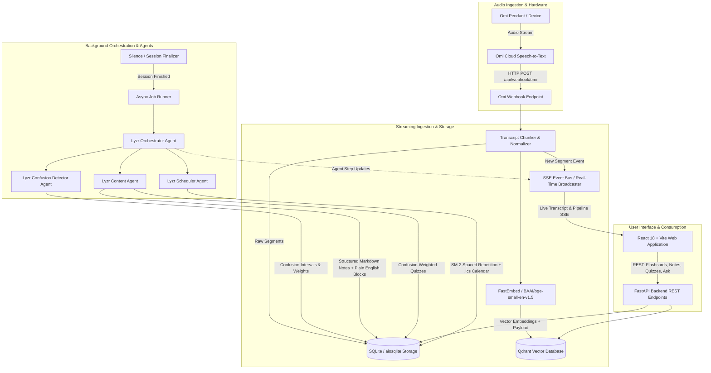

# ClassLoop System Architecture

ClassLoop is an ambient AI learning assistant that listens to university lectures via the [Omi](https://omi.me) wearable pendant, detects student confusion points during speech in real-time, builds an indexed semantic vector store using Qdrant, orchestrates specialized Lyzr AI multi-agent workflows, and renders interactive study artifacts (hierarchical notes, confusion-weighted quizzes, spaced-repetition schedules, and cited Q&A) in a responsive React frontend.

---

## 1. System Overview Architecture Diagram



---

## 2. Lyzr Multi-Agent Roles & Responsibilities

The agentic post-lecture pipeline leverages Lyzr-managed multi-agent chains with clearly delineated boundaries and fallback policies.

| Agent Name | Lyzr Agent ID Variable | Primary Objective | Inputs | Key Outputs |
| :--- | :--- | :--- | :--- | :--- |
| **Orchestrator Agent** | `LYZR_ORCHESTRATOR_AGENT_ID` | Coordinates execution lifecycle, manages intermediate state, enforces timeout controls, and tracks telemetry across pipeline stages. | Raw lecture transcript segments, session metadata, audio duration. | Directed execution dag status, step timestamps, consolidated artifact bundle. |
| **Detector Agent** | `LYZR_DETECTOR_AGENT_ID` | Analyzes lecturer tone, student interventions, repeated phrasing, pacing variations, and voice triggers to locate points of friction. | Chronological transcript segments, speaker tags, student flag utterances. | Scored confusion intervals (`start_time`, `end_time`, `severity_score` 1-5, `trigger_reason`, `concept_label`). |
| **Content Agent** | `LYZR_CONTENT_AGENT_ID` | Synthesizes educational content; breaks down dense topics into "Explained Simply" intuition blocks, formula breakdowns, and adaptive flashcards. | Transcript segments, detected confusion intervals, Qdrant semantic context chunks. | Hierarchical Markdown notes, conceptual glossaries, 5-10 question quizzes weighted toward confusing topics with verbatim citations. |
| **Scheduler Agent** | `LYZR_SCHEDULER_AGENT_ID` | Calculates spaced repetition schedules tailored to the user's exam timeline and topic difficulty using an adapted SuperMemo SM-2 algorithm. | Lecture timestamp, detected difficulty distribution, course schedule parameters. | Spaced review intervals (Day 1, 3, 7, 14, 30), calendar sync payload, downloadable `.ics` iCalendar file. |

---

## 3. End-to-End Data Flow

1. **Ambient Capture & Ingestion**:
   - The Omi wearable pendant captures continuous lecture audio and streams transcript segments to the Omi backend.
   - Omi forwards incoming transcript chunks via an authenticated webhook (`POST /api/webhook/omi`) with HMAC-SHA256 payload verification.
   - In demo mode, a replay utility streams pre-recorded segmented transcripts into the ingestion buffer.
2. **Chunking & Vector Indexing**:
   - Transcripts are buffered into configurable chunks (default: 45 seconds or logical speech boundaries).
   - Segments are persisted immediately to the transactional SQLite store via `aiosqlite`.
   - Chunks are embedded on-the-fly using `fastembed` (`BAAI/bge-small-en-v1.5`) producing 384-dimensional dense vectors.
   - Vectors with rich metadata payloads are upserted into Qdrant (`lecture_chunks` collection).
3. **Event Dissemination**:
   - The in-memory Server-Sent Events (SSE) bus broadcasts `transcript_segment` events to connected frontend clients within <100ms.
4. **Session Finalization & Pipeline Triggering**:
   - A rolling silence timer triggers session completion when no new audio arrives for `SILENCE_TIMEOUT_SECONDS` (default: 90s), or when the user manually taps "Finish Lecture" in the UI.
   - The session state transitions from `recording` to `processing`.
5. **Multi-Agent Pipeline Processing**:
   - The async job runner launches the Lyzr Orchestrator.
   - Step 1: Detector Agent inspects the full transcript for confusion cues and stores confusion markers.
   - Step 2: Content Agent queries Qdrant for topic context and outputs structured notes, simple intuition analogies, and self-test quizzes.
   - Step 3: Scheduler Agent computes optimal review intervals based on difficulty scores.
   - Each state transition broadcasts SSE events to render a real-time progress bar and status badge in the UI.
6. **Artifact Consumption & Cited Q&A**:
   - Students review lecture notes, take adaptive quizzes with instant citations linking directly back to lecture timestamps, and export `.ics` review calendars.
   - The "Ask My Lecture" tab executes hybrid retrieval (dense vector search over Qdrant + session context) to answer student questions with verified audio-transcript citations.

---

## 4. Confusion Detection Engine Design

Confusion detection runs on a dual-pass evaluation architecture combining real-time heuristic triggers and post-lecture LLM validation:

### 4.1 Real-Time Heuristic Signals (Pass 1)
- **Explicit Voice Markers**: Student voice commands such as *"ClassLoop, mark this as confusing"*, *"I didn't get that"*, or *"Can you repeat that?"* detected via fuzzy token matching (`is_user=True` or student speaker role).
- **Lecturer Rhetorical Signals**: Phrases indicating complexity or checking comprehension:
  - *"Does that make sense?"*
  - *"This usually trips people up..."*
  - *"Pay close attention here, this is tricky..."*
  - *"In other words..."* (indicates an immediate re-explanation attempt)
- **Pacing & Repetition Anomalies**: Segments where the lecturer speaks at unusually slow or rapid words-per-minute (WPM), or repeats core technical terms >3 times within 60 seconds.

### 4.2 Agentic Semantic Verification (Pass 2)
The Lyzr Detector Agent processes the aggregate transcript against the following rubrics:
- **Cognitive Load Assessment**: Identifies mathematical transformations, abstraction jumps, or high-density definitions.
- **Resolution Verification**: Checks whether the lecturer successfully resolved the ambiguity in subsequent sentences. If resolved, severity is discounted from Level 4 to Level 2.
- **Severity Scoring (1-5 scale)**:
  - `Level 1`: Minor terminology clarification.
  - `Level 3`: Multi-step algorithmic process requiring review.
  - `Level 5`: Unresolved student question or foundational prerequisite failure.

---

## 5. Qdrant Payload Schema

Collection name: `lecture_chunks`  
Vector dimensions: 384 (FastEmbed BAAI/bge-small-en-v1.5, Cosine similarity)

```json
{
  "id": "e9a0c20a-6663-4ce4-8e54-585a9ff92c57",
  "vector": [0.0341, -0.0128, 0.0894, "..."],
  "payload": {
    "session_id": "session_demo_001",
    "course_id": "cs_301",
    "lecture_title": "Deadlock Fundamentals and Prevention",
    "chunk_index": 4,
    "text": "Condition number one is Mutual Exclusion: at least one resource must be held in a non-shareable mode. That means only one process at a time can use the resource.",
    "speaker": "lecturer",
    "start_timestamp": 121.0,
    "end_timestamp": 149.5,
    "has_confusion": true,
    "confusion_score": 3,
    "keywords": ["mutual exclusion", "non-shareable", "coffman conditions", "resources"],
    "created_at": "2026-10-11T12:00:00Z"
  }
}
```

Indexed payload fields for filtered vector queries:
- `session_id` (keyword index)
- `course_id` (keyword index)
- `has_confusion` (boolean index)
- `start_timestamp` (float index)

---

## 6. Privacy & Ephemeral Data Model

ClassLoop operates under a zero-retention, student-first privacy principle:

1. **Ephemeral By Default**:
   - Inactive raw audio transcripts are subject to an automatic expiration TTL (`EPHEMERAL_TTL_HOURS=24`).
   - Sessions can be permanently purged on demand with a single click in the Privacy Vault.
2. **Local Storage First**:
   - SQLite database runs locally (`./data/classloop.db`) or inside an encrypted isolated persistent container.
   - Local vector store option via Qdrant embedded mode (`./data/qdrant`), removing external cloud dependencies for privacy-conscious institutions.
3. **Data Anonymization**:
   - Student identities are isolated using ephemeral session identifiers (`session_UUID`).
   - Webhook tokens and admin API keys use cryptographic salting and constant-time comparisons.
4. **Hard Purge Workflow**:
   - Triggering `DELETE /api/sessions/{session_id}` cascade-deletes the session, all raw segments, generated notes, quizzes, Qdrant vectors matching `session_id`, and cached audio pointers.

---

## 7. Background Job Runner Architecture

ClassLoop employs an asynchronous in-process queue runner backed by `asyncio` tasks:
- **Concurrency Control**: Prevents overwhelming the embedding and Lyzr API endpoints by maintaining a configurable worker semaphore (default: 2 concurrent agent pipelines).
- **Session Locking**: Prevents concurrent runs for the same lecture session using mutex key locks.
- **Resilience & Fallbacks**:
  - Each pipeline step (Detection $\rightarrow$ Notes $\rightarrow$ Quiz $\rightarrow$ Schedule) includes retry logic with exponential backoff (max 3 retries).
  - If external Lyzr agent APIs are unavailable or unconfigured, the job runner gracefully switches to built-in local deterministic mock fallback engines to prevent pipeline stalls.
- **Heartbeat & Zombie Reclamation**: Unfinished jobs running over 10 minutes are automatically marked as failed with detailed error diagnostics written to SQLite.

---

## 8. Server-Sent Events (SSE) Protocol

Clients establish a unidirectional event stream via `GET /api/events?session_id={session_id}`.

### Supported Event Types

| Event Name | Frequency | Payload Content | Purpose |
| :--- | :--- | :--- | :--- |
| `connected` | Once on connect | `{"client_id": "...", "status": "ok"}` | Initial handshake and ping verification. |
| `transcript_segment` | Real-time during lecture | `{"id": "...", "text": "...", "speaker": "...", "start": 12.0, "end": 18.5, "is_user": false}` | Streams live transcribed speech directly to the active live feed. |
| `confusion_detected` | As triggers arise | `{"segment_id": "...", "timestamp": 121.0, "score": 4, "reason": "Explicit voice marker"}` | Triggers immediate warning badge and waveform highlight in UI. |
| `session_status` | On state change | `{"session_id": "...", "status": "recording" | "processing" | "completed"}` | Updates global lecture state indicator. |
| `agent_progress` | During Lyzr pipeline | `{"agent": "detector", "step": 1, "total_steps": 4, "message": "Analyzing speech pace..."}` | Drives dynamic multi-step agent pipeline progress tracker. |
| `pipeline_completed` | When all jobs finish | `{"session_id": "...", "artifacts": ["notes", "quiz", "calendar"]}` | Notifies client to refresh lecture dashboard and unlock artifacts. |
| `error` | On failure | `{"code": "AGENT_TIMEOUT", "message": "Lyzr API timed out; using cached fallback"}` | Displays actionable warning toast in the user interface. |
